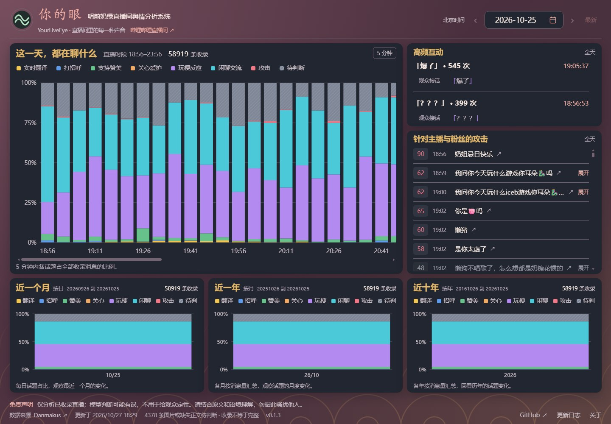
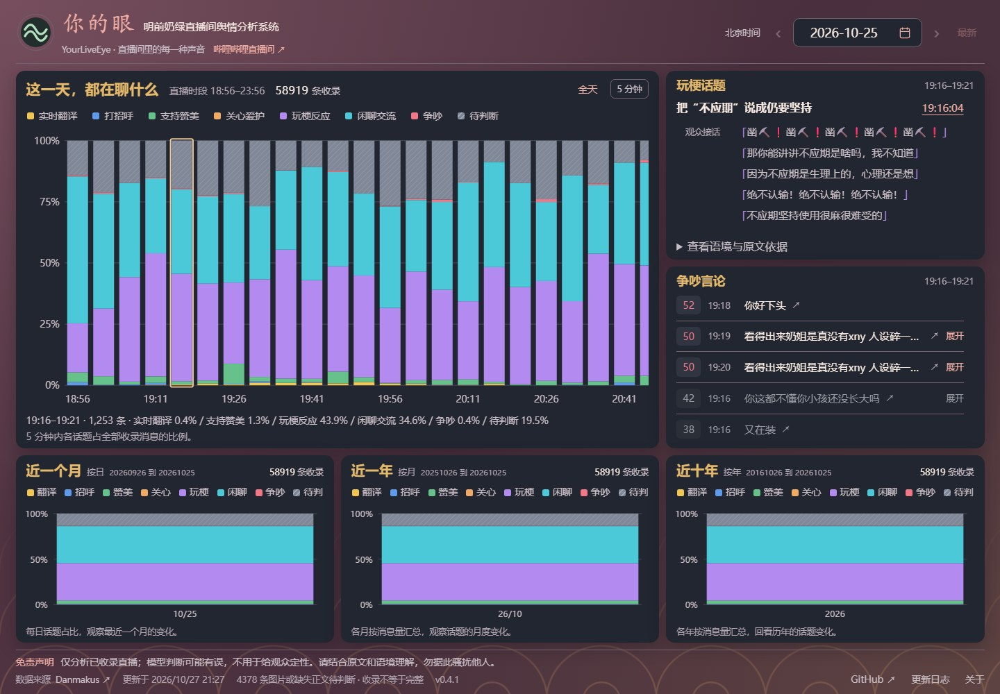
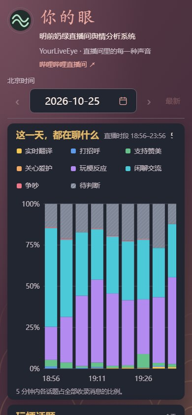
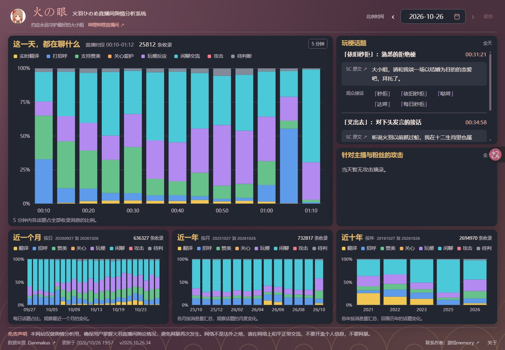

<div align="center">


# 你的眼 · YourLiveEye

**给 Agent 一个直播间，让每一种声音都有迹可循。**

[](https://github.com/TaurusGGBOY/your-live-eye/actions/workflows/tests.yml)
[](pyproject.toml)
[](LICENSE)

[明前奶绿 Demo](https://your-live-eye-demo.pages.dev/) · [火之眼原站](https://best-hinome.pages.dev/) · [部署文档](docs/deployment.md) · [内置 Skill](.agents/skills/your-live-eye-setup/SKILL.md) · [反馈问题](https://github.com/TaurusGGBOY/your-live-eye/issues)

</div>

给 Agent 一个 B 站 UP 主的 **UID、昵称或链接**，从公开直播档案生成分类页面，并完成局域网或 Cloudflare 部署和每日更新。

“你的眼”替你观察直播间里的每一种声音；开源仓库与命令名为 `your-live-eye`，英文标识 YourLiveEye。本项目从 Hinome 抽取，运行不依赖原项目目录、私有数据库、服务器或主播素材。

## 在线体验

**明前奶绿 Demo**：2026-10-25 最近收录的完整场次，58,919 条 Message/SC，展示分类、五分钟下钻及攻击措辞强度。Demo 只保留一天；正式初始化默认全部已结束历史。

**[打开明前奶绿 Demo ↗](https://your-live-eye-demo.pages.dev/)** · **[打开火之眼原站 ↗](https://best-hinome.pages.dev/)**

Demo 已部署到 Cloudflare Pages，无需安装即可查看。它是固定单日展示；源码中的每日更新能力需部署者在自己的账号配置后启用。



## 内置初始化 Skill

项目自带 [your-live-eye-setup](.agents/skills/your-live-eye-setup/SKILL.md)，随源码一起提供。Agent 先确认主播、正式全历史或轻量 Demo、模型、Cloudflare 配置、日更时间与时区，并在开始前给出有依据的耗时范围。已有选择直接复用，不要求用户另写 Skill。耗时较长时每 5 分钟报告完成量和更新预计剩余时间。

## 一句话交给 Agent

> 阅读 AGENTS.md 和内置初始化 Skill，确认我要分析的主播与部署配置，按正式全历史模式生成舆论分析页面，并设置每天北京时间 04:00 补齐更新。若缺少模型权限，说明需要我完成哪一步登录或模型选择。完成后给我可访问网址、实际覆盖场次和分类数量。

## 一键运行

需要 Python 3.11+、网络，以及一个可用模型。默认调用**已登录的 Codex CLI**，使用 `gpt-6-luna` / high / Fast。模型权限因账户不同；可用 `--model`、`--reasoning`、`--tier` 调整，不会偷偷换模型。首次需要用户自己完成 `codex login`。

先拉取项目：

```bash
git clone https://github.com/TaurusGGBOY/your-live-eye.git
cd your-live-eye
```

在项目目录执行：

```bash
./run.sh run "明前奶绿" --deploy --schedule
```

Windows PowerShell：

```powershell
.\run.ps1 run "明前奶绿" --deploy --schedule
```

入口自动建立独立 Python 环境并安装依赖，随后执行：身份解析 → 全部已结束历史直播 → 原始归档 → 直播边界过滤 → 括号规则 → 去重文本批量分类 → 攻击语境复核与强度同次输出 → 数据对账 → 静态页面 → 常驻服务 → 每日定时任务。首次下载依赖和模型运行需要时间；进度输出为 JSON，Agent 可直接读取。

首次正式运行默认 `--date all`，覆盖来源目录中**全部已结束的历史直播**。轻量示例需要明确选择：

```bash
./run.sh run "明前奶绿" --demo --deploy
```

`--demo` 只初始化最近已结束场次；上面的在线 Demo 固定保留一天。

同样支持：

```bash
./run.sh resolve "https://live.bilibili.com/25034104/"
./run.sh run 2132180406 --deploy --schedule
./run.sh run "https://space.bilibili.com/2132180406" --deploy --schedule
./run.sh run "明前奶绿" --date 2026-10-26 --fallback-latest --deploy --schedule
```

昵称必须唯一精确匹配来源。指定日期没有档案时，默认报出缺口；只有 `--fallback-latest` 才改用最近场次，并保存原因。不同主播使用不同 `STATE/<UID>/`；第二个同时部署的页面请用另一个 `--port`。

## 大概要等多久？

**单日 Demo 建议预留 20–40 分钟；数百万条历史的主分类是小时级。** 以约 267 万条历史消息为例，完整首次初始化先按 **6 并发约 6–12 小时、默认 2 并发约 12–24 小时**做预算，再由 Agent 根据下载和复核的实际速度修正。后两个范围是规划估算，尚不是开源版全历史端到端实测；不能只按直播“场数”乘单日时间。

### 两次真实运行的参考

| 实测范围 | 参数与实际时间 |
| --- | --- |
| 明前奶绿单日 Demo：约 5 小时直播、58,919 条消息、23,693 种原文 | Luna high / Fast，3 并发；分类与语境复核约 **13 分钟**，首版独立补评分约 **1 分钟**。新流程已将评分并入复核。 |
| 火之眼 2026-10-27 存量重跑：**1,088 份来源、2,670,437 条可读事件** | Luna high / Fast，6 并发、最多 8,192 条/批；主分类 **3 小时 22 分 14 秒**（15:08:28–18:30:42）。规则处理 416,055 次事件，模型有效处理 1,348,928 种原文。 |

火之眼实测是**已有档案上的全量主分类**：有效覆盖 2,670,419 次，另 18 次执行缺失保留，49,640 次虽有输出仍属模型未决；不称为 100% 完成。攻击候选复核和评分在主分类后另行执行，截至本次记录仍未结束，首次下载与最终部署也不在 3 小时 22 分内。详见 [耗时依据与估算口径](docs/runtime-estimates.md)。

### 每个阶段大致多久

| 阶段 | 单日 Demo，约 6 万条 | 百万级历史参考 |
| --- | --- | --- |
| 安装环境、解析主播 | 2–10 分钟 | 2–10 分钟，主要是一次性工作 |
| 下载、解码与整理 | 1–3 分钟 | 暂预留 15–60 分钟；首次全历史下载未实测，网络和限流可能延长 |
| 主分类 | 与复核合计约 10–25 分钟 | 约 267 万条、6 并发实测 **3 小时 22 分**；默认 2 并发仅按吞吐换算约 **10 小时**，未实跑该组合 |
| 攻击语境复核与强度评分 | 已含在上一行；Demo 新流程同次输出 | 6 并发暂预留 **1–4 小时**，默认 2 并发暂预留 **3–12 小时**；候选比例、上下文长度和接口限制会影响实际值 |
| 生成页面、部署与回读 | 1–5 分钟 | 5–20 分钟，属于预算，不含账号授权等待 |

表中的阶段预算不都是独立实测，总预算取整给用户安排时间；一旦小批速度与预算不符，Agent 会更新剩余时间。火之眼的主分类与评分合批方式和本项目不同，不把它的吞吐直接承诺为每个主播、每种模型的速度。默认并发为 2；账号支持时可显式传 `--concurrency 6`，并发增加不保证线性提速。

日常没有新内容时，通常 **1–3 分钟**完成检查；新增一场相近规模的直播可先按 **15–35 分钟**安排。重复原文复用已完成结果，所以全历史、每天增量都不应简单按场次重复计费和计时。同一配置中断后用 `resume`；本 Demo 全部复用结果的恢复实测约 **10 秒**，不能拿这个数字宣传首次运行速度。

内置 Skill 会先核对真实消息量、去重原文数和模型参数，用小批实测修正预计时间，运行中每 5 分钟报告进度。GitHub 托管任务每次约 4.5 小时保存进度；如果只每天运行一次，日历等待会长于实际处理时长，手动继续运行可接续未完成内容。

## 页面与分类

- 直播内 Message/SC 全部计数，五分钟分类柱、日历、日期导航、近月/年/十年分布与下钻。
- 同文只做一次模型判断，出现多少次就统计多少次；不会把重复弹幕的事件次数丢掉。
- `【` 或 `】` 字面格式直接归翻译；其余批量调用模型。八类包括翻译、招呼、支持、玩梗、闲聊、攻击、待判断、关心。
- 初判的“攻击批评”是候选，经当前主播/粉丝对象和上下文复核后才展示为攻击。普通批评归闲聊，未确认语境归待判断。
- 攻击摘录补充 1–100 分措辞强度，低于 50 分淡化；分数不是恶意概率或分类置信度，无法评分保留“待评分”。
- 每个五分钟时段按强度展示最多十条匿名攻击摘录；高频互动展示实际原文频次。没有迁入火羽专属梗解释和人工词表。
- 图片和缺失 SC 正文不伪装成已读懂，保留待判断。语义准确率没有用这次 Demo 建立人工真值评测，不能把工程通过理解成分类百分之百正确。

“任意 UP 主”指身份输入不写死；**有可访问公开档案**才有历史弹幕可分析。本项目不会补造未收录直播，也不是实时采集器。默认来源是 [Danmakus](https://danmakus.com/)。遇到同名、无档案、权限/限流或模型不可用时给出明确失败原因。

点击五分钟柱，右侧同步切到相应时段，原文与分数一起显示：



手机也可以查看：



## 数据目录

默认状态目录与源码分离：macOS 为 `~/Library/Application Support/YourLiveEye/`，Linux 为 `~/.local/share/your_live_eye/`，Windows 为 `%LOCALAPPDATA%/YourLiveEye/`。可用 `--state` 或 `YOUR_LIVE_EYE_STATE` 改动。每个 UID 独立；首次输出会给出准确配置路径。macOS 后台服务另装独立 runtime，避免依赖外置盘源码路径。

## 恢复与日常管理

```bash
# 将 CONFIG 设为首次运行输出的路径；下面为 macOS Demo 示例。
CONFIG="$HOME/Library/Application Support/YourLiveEye/2132180406/config.json"
./run.sh status --config "$CONFIG"
./run.sh resume --config "$CONFIG"
# 仅在看过失败原因并修复后，给失败批次增加一次明确重试机会：
./run.sh resume --config "$CONFIG" --retry-failed
./run.sh rebuild --config "$CONFIG"
./run.sh verify --config "$CONFIG"
./run.sh schedule --config "$CONFIG" --print-only
./run.sh unschedule --config "$CONFIG"
./run.sh stop --config "$CONFIG"
```

模型成功项立即入库，漏 ID 只补缺项。中断后继续已有队列；失败不会推进成功检查点。更换模型或提示时使用新的 `--state` 路径，旧结果保留，不把不同配置混成同一轮。

定时器以北京时间 04:00 为每日界线，每 15 分钟唤醒检查：当天已成功则不再调用来源/模型；正式全历史配置每天重新核对整个目录，补齐遗漏、失败、此前未结束及迟到的旧场次；已完成消息复用分类，并复查最近三天档案。每个日更周期最多自动尝试一次，失败保留成功进度，下一天补跑；需要马上重试可手动 resume。macOS 使用 launchd，Linux 使用用户级 systemd，Windows 使用任务计划；需要主机和网络可用。可用 `--update-at HH:MM --timezone Asia/Shanghai` 设置其他时间；本机每 15 分钟检查，实际启动可能晚于设定时间至多一个检查周期。详情见 [部署](docs/deployment.md)。

## Cloudflare 发布 Action

自带 [.github/workflows/cloudflare.yml](.github/workflows/cloudflare.yml)，**默认使用 GitHub 托管的 `ubuntu-latest`，不需要自备服务器或安装 runner**。公开仓库的标准 runner 可免费使用，私有仓库按账户额度计算；模型 API 和状态存储按各自服务计费，见 [GitHub 官方说明](https://docs.github.com/en/actions/concepts/billing-and-usage)。

手动 `update` 首次初始化或补齐，`publish` 发布已完成的数据；开启日更后每天北京时间 04:00 补齐并发布。GitHub 每次分配新机器，项目用**私有 Cloudflare R2** 保存数据库、队列和已完成结果，下一次恢复后只处理缺项。约每 15 分钟在批次边界保存，运行到约 4.5 小时主动保留进度退出，下次继续；完整数据准备好后更新页面。

Agent 按 [Cloudflare 配置步骤](docs/deployment.md#cloudflare-pages-action) 填好主播 UID、可用 API 模型、Pages 项目、私有状态桶和 Secrets。已有常驻主机的用户可选择 `YOUR_LIVE_EYE_RUNNER=self-hosted`，继续使用本机 Codex 登录及持久目录；这是可选方式。源码包含完整 Action，但下载代码不会自动开启云账号、收费服务或日更。

## 导出与公开托管

```bash
./run.sh export --config "$CONFIG" --output dist/mingqian
```

导出目录只有页面和匿名展示数据，可交给 Nginx、Caddy 或 Cloudflare Pages。原始归档、观众身份、模型请求回执、配置和数据库留在独立 STATE 目录，不进入静态站。查看 [部署方式与命令](docs/deployment.md)。公网账户登录与发布单独执行；本项目不会使用原 Hinome 的域名、IP、SSH 密钥或云账号。

## 来自「火之眼」

本项目抽取自 **[火之眼（火の眼 · Hinome）](https://best-hinome.pages.dev/)**，原站面向火羽ひのめ直播间，保留其专属背景、梗解释及人工口径；「你的眼」提供独立的主播解析、分类流程、日更和部署，不依赖原站数据库，也不会直接沿用火羽专属判断。



截图为 2026-10-27 实际浏览器页面；明前奶绿与火之眼截图均来自各自的公网实际页面。画面中的历史数据和模型结论不表示已完成独立人工准确率评测。截图来源及版本见 [截图说明](docs/images/README.md)。

## 开发与证据

```bash
python3 -m venv .venv
.venv/bin/python -m pip install -e .
.venv/bin/python -m unittest discover -s tests -v
```

[隐私检查](docs/privacy-review-20261027.md) · [GitHub runner 与 Demo 发布记录](docs/cloudflare-demo-20261027.md) · [v0.2 初始化与 Skill](docs/initialization-cloudflare-20261027.md) · [架构及抽取范围](docs/architecture.md) · [真实 Demo 验收](docs/demo-20261027.md) · [来源与授权](NOTICE.md) · [MIT License](LICENSE)

本仓库只包含可独立安装的源码、合成测试和文档。不要将 `.state`、真实弹幕全档或账号凭据提交到开源仓库。
