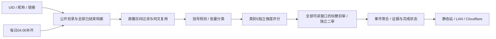

# 架构与抽取范围

## 分类与强度

新数据使用 `primary_quarrel.txt`，类别5名称为“争吵”，包含既有指责/贬损范围，不要求双方反复争执；与原类别编号一致。本次是命名和流程同步，不是新增跨主播质量评测。含任一【或】的原文按已确认字面规则归翻译；其他文本按所选模型分类。未提供图片不假装读懂。

`intensity.txt` 只给1–100表达强度，不复核类别，低分仍留在类别5。不是恶意概率、真实性、作者动机或分类置信度。默认2048条/批，按字节预算拆分；并发沿用用户配置（默认2）。缺失/格式错误只补未成功ID，0不是成功评分。

同一主播的相同原文跨Message/SC复用判断，事件次数保留；新场次不会因新增邻近话语自动重判同文。没有搬入特定主播训练的本地模型、人工票或梗词典。

## 旧数据升级

已完成分类和分数原样保留。未完成旧 `primary` 按冻结提示只处理已有队列；新原文进入 `primary_quarrel`。旧 `review/review_scored/severity` 的未完成任务标记superseded并保留回执，不能在下次日更又重分类。已有初判5但没有最终类别时保留初判5，再补缺失强度。旧复核已改成其他类的结果不会擅自改回5。

因此升级后的历史可能来自旧流程，新数据来自新流程，页面注明保留既有结果；这不是全量统一重判。完整重新分类属于单独任务，不为代码升级另建状态目录重复付费。冻结提示文件与旧实验回执不改写。

## 玩梗增量审核

`memes.py` 比较实际直播区间、可读原文、种类、时间和行号，忽略归档文件路径/mtime与无关标题。新增、补录、删除或正文变化会重新准备受影响来源；一致的分片复用成功结果。按五分钟读取全部可读观众文本，同文合组但保留每次出现；忙时按字节预算拆片。SC保留同场此前文本，同传含附近五分钟，稀疏时取前后最近各十条，均保留真实时间。不截断超预算上下文，明确报错。

初审可给“已审核未确认”或“上下文不足”，不强凑话题。候选必须有SC或同传支撑，SC还需连接证据；后发SC不能解释先前反应，观众话和同传不冒充音视频。工程核对原文编号、类型、时间及真实接话范围，然后独立二审决定保留/否决。

按可核对的接话事件去重排序，全天Top2、每五分钟Top1；解释与证据来自实际代表片段。旧日未做语义审核时仅显示“高频互动”原文频次，并标明未审核。页面可展开解释与来源依据。两次模型意见一致不是人工准确率。

每来源保存冻结输入、提示、参数、分片回执和状态；全部完成才替换该来源accepted结果。失败保留既有发布结果，整体日更不推进成功检查点；`--retry-failed` 补失败阶段，成功阶段不重跑。`review-memes --config ...` 可单独补审核，不下载或重分类，也不自动发布。

## 状态与部署

`STATE/<UID>/` 存配置（无凭据）、`raw/`档案、SQLite事件与分类、`prompts/`及`attempts/`冻结回执、`memes/`语义状态、覆盖/进度/成功检查点、`releases/`静态快照。仅用已有OS锁、SQLite唯一键和文件原子替换，不另加内容哈希。

正式首次默认全历史；Demo是明确选择。每日重查整个目录与最近三天档案，补失败、迟到和此前在播场次。分类、评分、语义审核和对账完成才发布。

Cloudflare Action默认GitHub托管runner，私有R2保存原始资料、SQLite及`memes/`状态，包含中断分片，不能上传公共artifact/cache。公开Pages只收到静态页面、汇总和选定匿名摘录，原文仍可能含其本身的个人信息，部署者需按数据用途审阅。旧账号登录、私有资料和作者设备地址不在源码中。模型、网络、归档可用性及云端容量仍是外部限制。
