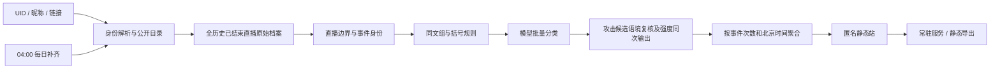

# 架构与抽取范围

## 从旧项目保留的能力

保留来源 MessagePack 解码、直播区间过滤、同文复用、逐条结果校验与缺项补跑、五分钟和日/月/年聚合、最新一天优先加载、日历和历史下钻、按时段攻击原文、更新日志。源码出处见 [NOTICE](../NOTICE.md)。

剥离了写死的主播 UID/房间、个人标题与素材、私有服务器地址/用户、原项目路径、历史源清单、模型二进制、个人人工票和主播梗词表。新项目自备公开来源适配、可选模型接口、独立 SQLite 状态、配置、服务安装和跨平台调度。

## 模型与判断边界

当前默认是括号规则前置，剩余原文全部模型判断，不依赖训练好的本地分类器。原项目 E5/轻量模型属于特定主播语料训练，本次没有把它当作已验证的跨主播模型搬入。

初判提示来自 Hinome 的紧凑批量提示：替换主播身份、同步字面括号规则，类别 5 保持“宽候选”用途。第二阶段检查当前主播/粉丝对象、作者立场、引用、普通批评和性化互动边界，输入最多三次出现、每次前后一分钟内最近八条邻近文字。邻近弹幕不是音视频事实；不同出现的语境未解决时允许未决。此路线是可运行的工程抽取，不是跨主播准确率证明。

同一原文在当前主播内跨 Message/SC 共用结果；不同主播隔离。相同原文新场次默认复用旧判断，不会因新增上下文自动重跑。需要改变定义/模型或完整重判时使用新的状态目录，不覆盖旧版本。不能自动推断作者身份、恶意或“黑子”标签。

高频互动是去重原文的事件频次，全天 Top 2、五分钟 Top 1；它不等同旧项目人工/语义核验的梗故事。本版避免把火羽私有梗迁移成其他主播事实。后续接入语义精选需提供可追溯 SC/同传证据。

## 状态与复现

`STATE/<UID>/`：

- `config.json`：身份、来源、模型、批量、并发、端口；不含凭据。
- `raw/<liveId>/`：原始响应、请求时间、场次目录；来源更新时保留旧响应。
- `analysis.sqlite`：事件 `(live_id, source_row)` 主键、完整原文组、初判/最终分类、批次/尝试。SQLite 自带唯一键处理同一来源重导入，不能按消息文本删除重复事件。
- `prompts/`、`attempts/`：冻结实际提示、每次发送/返回及用量。仅对未成功项补跑，保留失败回执。
- `progress.json`、`coverage.json`、`last-run.json`、`checkpoint.json`：分类进度、目录覆盖/失败场次、本次结果、已成功更新范围。
- `releases/`：不可变静态版本，`current.json` 原子切换访问目标；旧版保留可回滚。
- `access.json`、`schedule.json`、`logs/`：本项目服务、调度和日志。

数据文件的 atomic replace 和一个 OS 进程锁足以防止手动运行与日更同时写库/发布；没有新增内容哈希机制。只展示明确已处理数据；模型未决与执行未完成分别统计。

## 已知限制

归档不是完整直播历史；26 日查不到不证明未直播。第三方接口可能限流或下线。昵称精确匹配可能需要用户提供 UID。图片没有 OCR/视觉识别。没有主播音频转写，不对隐晦梗与反讽给出准确率承诺。非文本待判包含图片和缺失正文，并非都能归为图片。v0.2.0 正式模式默认全历史，每次日更检查全目录、只补缺或刷新已变更来源；显式 Demo/日期配置沿用该范围起的增量，不擅自升级已有 Demo。

## 分类与分数的同次输出

v0.1.2 的 `review_scored` 一次输出类别和力度，非攻击分数为0；攻击力度1—100，无法评分的0仅作为未知标志，页面不显示成“零攻击”。旧 `review` 队列只为中断恢复保留，`severity` 仅补历史缺字段；已经完成的分类/评分不会重跑。网页只读取完成的静态快照，不在打开时调用模型。

## 初始化 Skill 与 Cloudflare Action

项目 Skill 在 `.agents/skills/your-live-eye-setup/`，由根 AGENTS.md 路由。它确认身份/模式/模型/部署/时间，按同配置实测做 ETA，保留既有选择。正式全历史和显式 Demo 都调用同一 pipeline。某场次下载失败会记录并继续其他场次，成功分类保留；有未完成来源时不推进完成检查点或发布新站。

Cloudflare Action 默认使用 GitHub 托管的 ubuntu-latest，以私有 R2 保存和恢复 SQLite、原始档案及进度；可选 self-hosted 使用已有持久目录。执行 scheduled 或 update 后导出纯静态目录并用 Wrangler 发布。`publish` 只接受上次运行成功的配置；失败更新不会悄悄发布旧结果冒充新完成。模型密钥仅传处理步骤，Cloudflare Token 仅传上传步骤，私有状态不进入 GitHub artifacts/caches。默认不运行 PR 事件。
